

  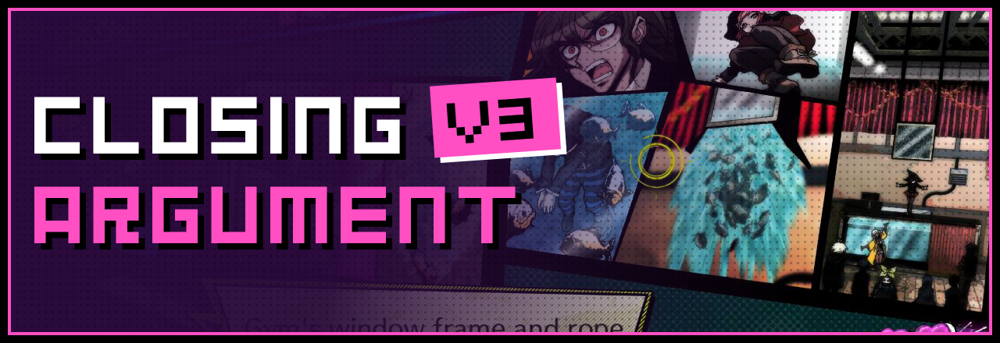

  
  
  

  

  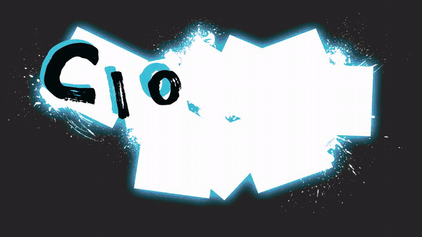

---

## 🧩 What is it?

**Closing Argument V3** brings Danganronpa V3's comic-book Closing Argument to your Danganmake trials. The crime is drawn as a comic with blank **"?"** panels. Flip through the pages, pick the right panel from your stock, and drop it into place until the whole case is rebuilt. When it's done, the finished comic plays back as a read-through with subtitles, voices and motion.

It comes with Chapters 1 and 2 ready to play, and an editor so you can make your own comics.

## ✨ Features

- 📖 **V3-style comic pages.** Page flipping, the panel stock, hints, the red circle and blue X, the timer and the health bar.
- 🎬 **Read-through at the end.** Your finished comic plays back panel by panel, with subtitles, voice lines, sounds and screen effects.
- 🛠️ **Page Builder.** Start from any of V3's own pages (Chapters 1 to 6) or draw your own panels, then set the "?"s, the answers, the hints and your own pictures.
- 🎞️ **Read-through editor.** Animate every picture with Premiere-style keyframes, 40+ ready-made motions (walk up, sneak in, drop in...), effects, and a timeline window with snapping clips.
- 💀 **Game Over and Time Up events.** Build what happens with Danganmake's own dialogue editor: lines, music, HUD, character sprites and the *"Would you like to retry?"* question.
- 🎮 **Controller support.** Play with a gamepad, and the button prompts switch to match.
- 🔊 **Danganmake's characters and sounds.** Voices and sounds are picked from Danganmake's own menus.

## 📸 Screenshots

<table>
  <tr>
    <td width="50%">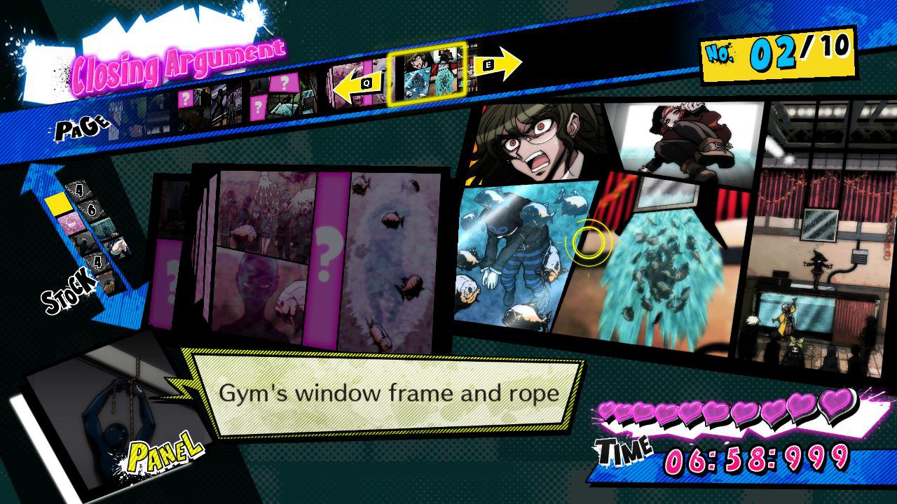</td>
    <td width="50%">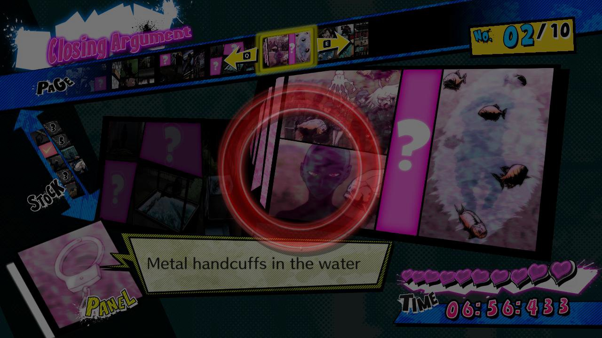</td>
  </tr>
  <tr>
    <td align="center">Pick a panel from the stock and find its "?"</td>
    <td align="center">The right panel snaps into the comic</td>
  </tr>
</table>

## 📥 How to install

Don't have Danganmake yet? **[Get it on itch.io](https://freddysdarkon.itch.io/danganmake)**.

1. Go to the **[Releases page](https://github.com/kfcbathroom25/danganmake-closingargumentv3/releases/latest)** and download the latest `.zip`.
2. Unzip it.
3. Drop the folders inside into your Danganmake **mods assets** folder.
4. That's it! **Closing Argument V3** now shows up in Danganmake's minigames.

> [!TIP]
> When a new version comes out, download it the same way and replace the old folders.

## 🎮 Controls

  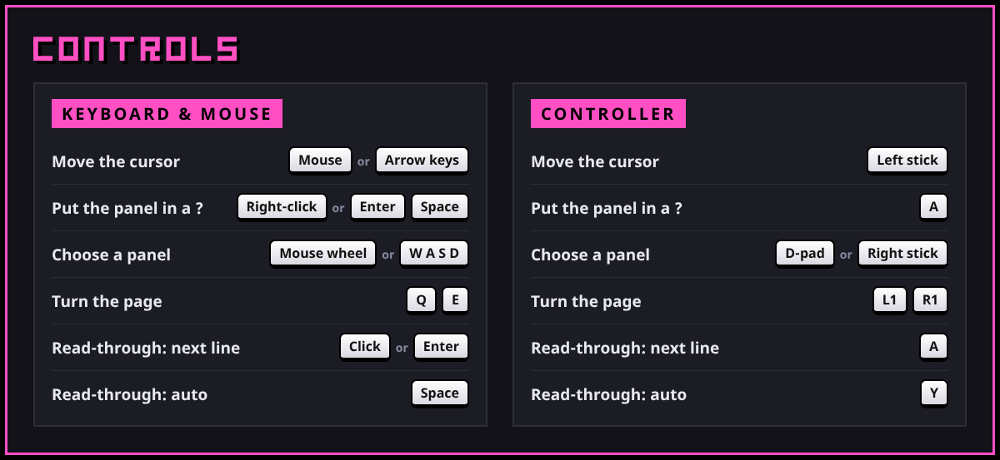

Controls as text

| Action | Keyboard & mouse | Controller |
| --- | --- | --- |
| Move the cursor | Mouse / arrow keys | Left stick |
| Put the panel in a "?" | Right-click / Enter / Space | A |
| Choose a panel | Mouse wheel / W A S D | D-pad / right stick |
| Turn the page | Q / E | L1 / R1 |
| Read-through: next line | Click / Enter | A |
| Read-through: auto | Space | Y |

## 🖌️ Make your own case

Insert the minigame in Danganmake's editor and its settings open:

<table>
  <tr>
    <td width="32%" valign="top">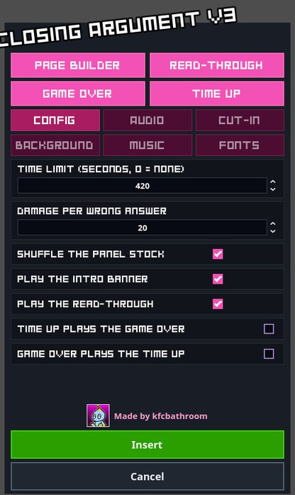</td>
    <td valign="top">
      <ul>
        <li><b>Page Builder:</b> make your own comic pages, panels, answers and hints.</li>
        <li><b>Read-Through:</b> edit the playback that runs when the comic is complete.</li>
        <li><b>Game Over / Time Up:</b> what happens when health or time runs out.</li>
        <li><b>Config / Audio / Cut-in / Background / Music / Fonts:</b> time limit, damage, intro, songs, colours and more.</li>
      </ul>
      
Press <b>Insert</b> to save it into your trial.

    </td>
  </tr>
</table>

### 📐 Page Builder

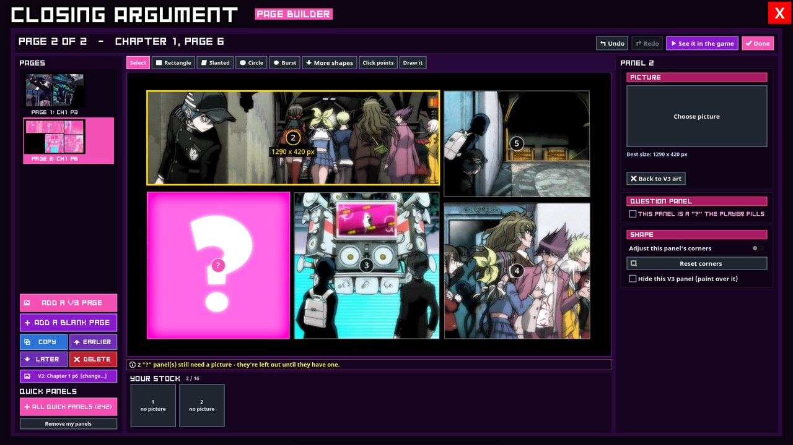

The Page Builder is where you make the comic yourself: the pages, their panels, which panels are a **"?"**, and what the player gets to put in them.

**Start a page.** Press **Add a V3 page** to start from any page of V3's Chapters 1 to 6, with its art, panels and "?"s already in place, or **Add a blank page** to draw everything yourself.

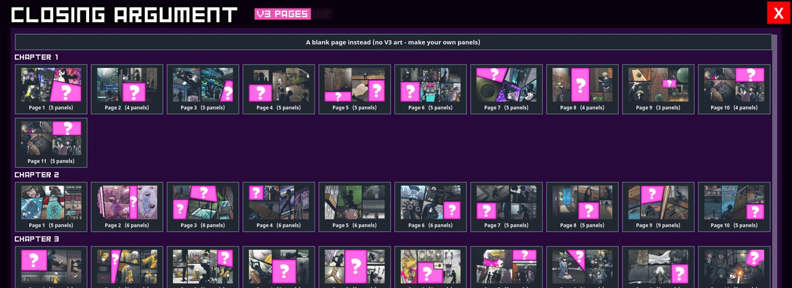

**Build it, step by step:**

1. **Draw your panels** with the tools above the page: **Rectangle**, **Slanted**, **Circle**, **Burst**, **More shapes**, **Click points** (a shape of your own, corner by corner) or **Draw it** (freehand). Drag a panel to move it, and use its corners to reshape it.
2. **Click a panel** to set it up on the right: give it a **picture**, tick **This panel is a "?" the player fills**, or adjust its corners.
3. **Fill the stock.** Every "?" panel goes into **Your stock**, the panels the player picks from.
4. **Use Quick panels** to drop in ready-made pictures from the game (242 of them), or add your own.
5. **Order the pages** with **Copy**, **Earlier**, **Later** and **Delete**. Undo and Redo work everywhere.
6. Press **See it in the game** to play it right away, then **Done**.

> [!NOTE]
> A "?" panel without a picture is left out of the puzzle until it has one. The yellow line under the page tells you what's still missing.

### The read-through editor

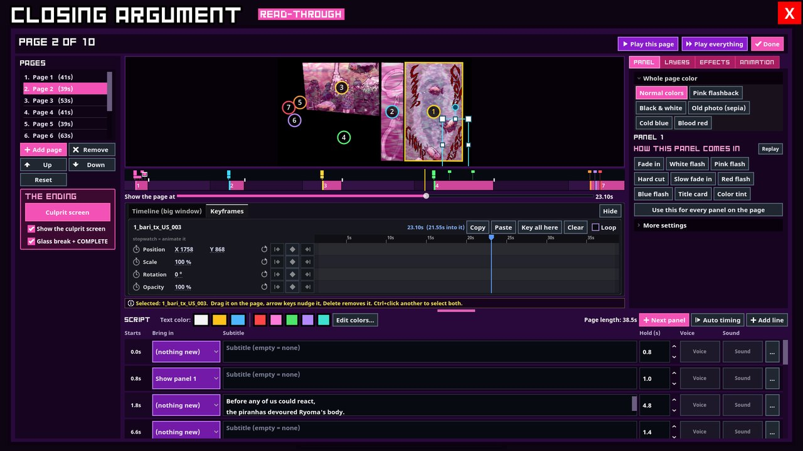

Every page is a set of panels with pictures on them. Click a picture to move, resize or turn it. Give it an entrance, an exit, a motion or an effect, and write the script lines at the bottom.

### Timeline and keyframes

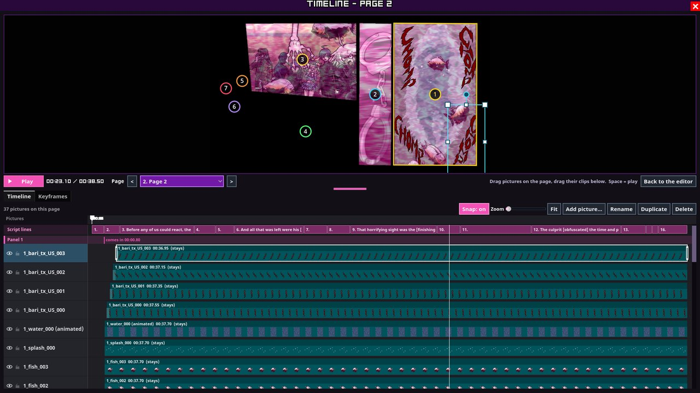

The **Timeline** tab opens a big window like a video editor: the page on top, and every picture as a clip underneath. Clips snap to each other, to the script lines and to the playhead. In the **Keyframes** tab, click a stopwatch, move the playhead and change the picture. That's an animation.

### Game Over / Time Up

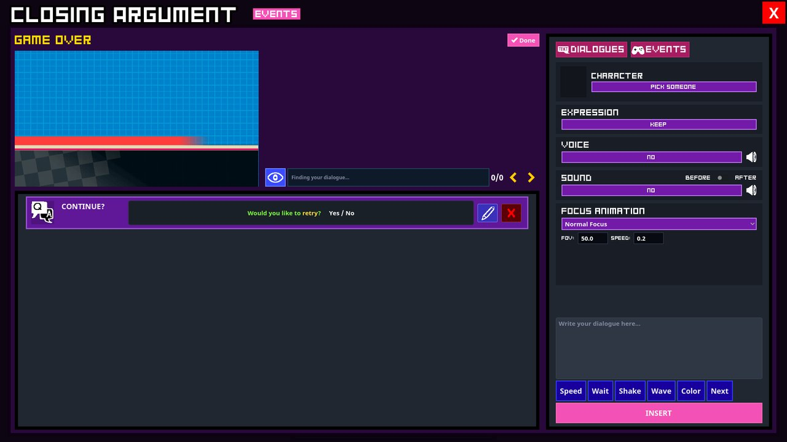

The same editor Danganmake uses for dialogue. Add lines, change the music or HUD, set someone's sprite, and place the **CONTINUE?** question.

## 💬 Credits

- **kfcbathroom**: Closing Argument V3 minigame
- **[Power2015](https://github.com/Power2015Dev)** and **[FreddysDark-on](https://github.com/FreddysDark-on)**: Danganmake and the minigame template
- [Danganmake documentation](https://power2015dev.github.io/Danganmake-Engine/content.html)

Danganronpa is © Spike Chunsoft. This is a fan-made minigame and is not affiliated with Spike Chunsoft.
